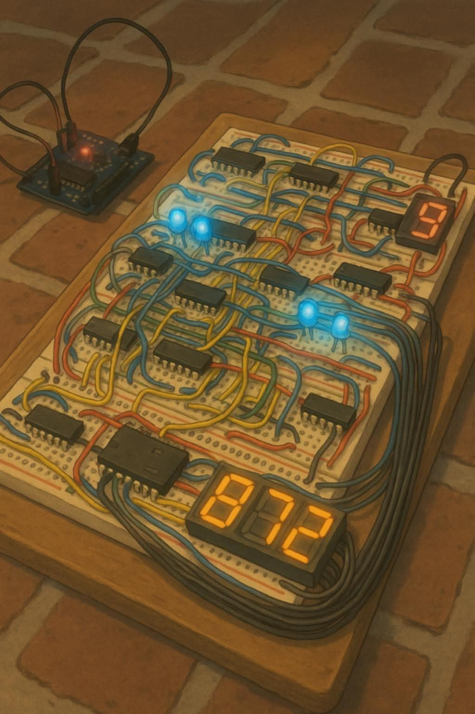

### Hi there! 👋 I'm Abraham Samuel (@AbrahamSGM)

I'm a Mechatronics Engineer from **Instituto Tecnológico de Mexicali**, currently pursuing a Master's degree in Computer Systems at **Tecnológico Nacional de México campus Mexicali**. My work focuses on low-level firmware development, microcontroller programming, and exploring the integration of Artificial Intelligence in edge microcontrollers (TinyML).

---

### 🛠️ Tech Stack & Tools

* **Languages:** C, C++, Assembly, Python
* **Microcontrollers & Hardware:** ESP32, ESP8266, Microchip PIC (PIC16/PIC18), Sensors & RTC modules
* **AI & Edge Computing:** TinyML, On-device Machine Learning, Sensor Drift Compensation
* **IoT & Cloud:** AWS IoT Core, MQTT, Data Pipelines
* **Tools & IDEs:** ESP-IDF, MPLAB X IDE, Arduino IDE, VS Code, Git, KiCad

---

### 🚀 What I'm Focused On
* Developing efficient bare-metal firmware and real-time task management.
* Integrating machine learning models directly into microcontrollers for intelligent agricultural IoT architectures.
* Researching sensor data collection, adaptation, and on-device data processing.

---

  

---

### 📊 GitHub Stats

  

